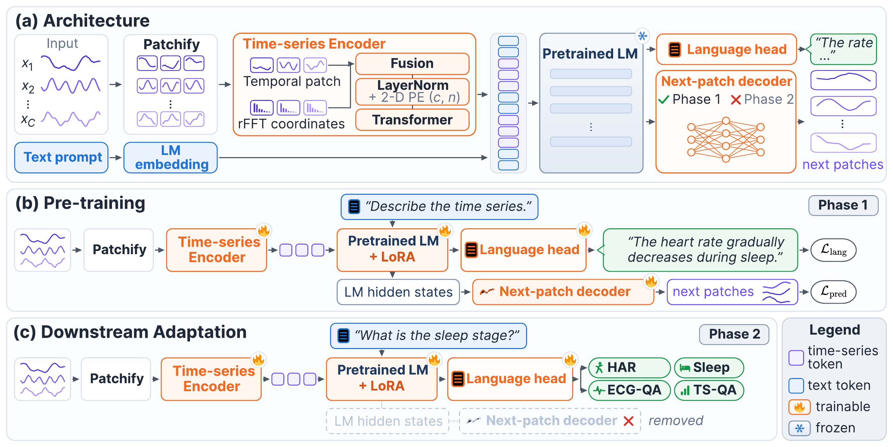
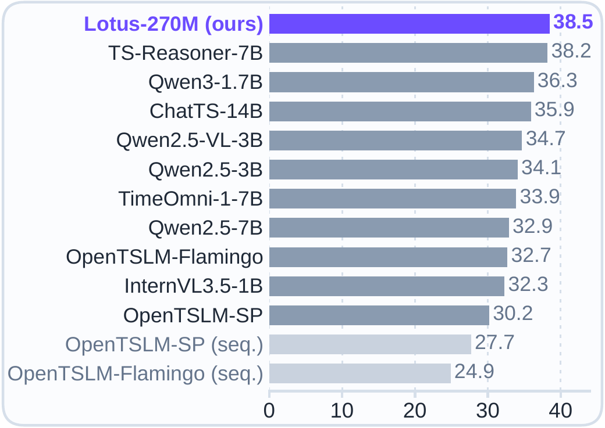
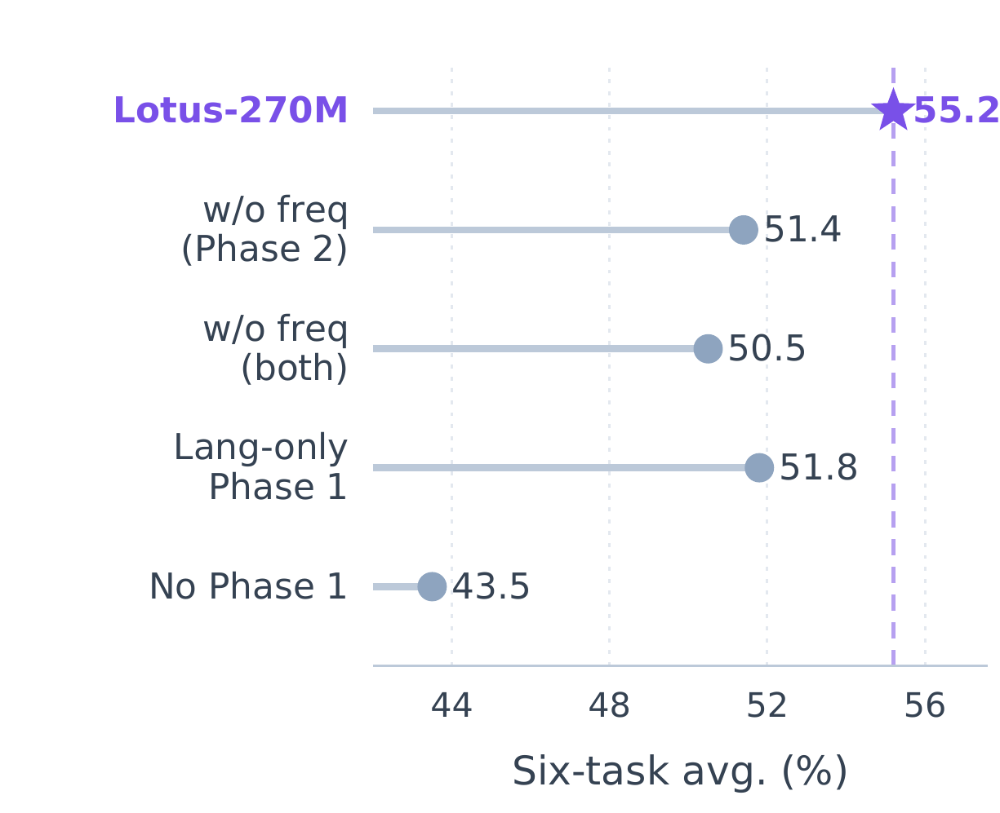

<div align="center">

# LOTUS: Learning to Understand Time-series by Learning to Forecast

[](https://arxiv.org/abs/2610.18877)
[](https://huggingface.co/hiepnh137/LangTimeFoundationModel)
[](LICENSE.md)
[](pyproject.toml)

Official implementation of **[Lotus: Learning to Understand Time-series by Learning to Forecast](https://arxiv.org/abs/2610.18877)**
<br>Van Dai Do, Huu Hiep Nguyen, Minh Hoang Nguyen, Manh Nguyen, Hung Le (Deakin University)

</div>



**(a) Architecture.** Each channel of a multivariate series is split into non-overlapping
patches; a time-series encoder maps every patch, in both temporal and spectral (rFFT)
coordinates, to a soft token in the language-model embedding space, where it is processed
jointly with text. **(b) Pretraining (Phase 1, forecast grounding).** Language supervision
trains the textual outputs while a next-patch decoder on the LLM hidden states of the
time-series tokens constrains them to retain future-relevant information. **(c) Downstream
adaptation (Phase 2).** The next-patch decoder is removed and the model is trained with
language supervision only.

LOTUS is a time-series language model trained under **forecast grounding**: a pretraining
principle that requires language-aligned time-series representations to remain predictive
of the future evolution of the signal before they are adapted to downstream tasks. Across
three language-model backbones and six downstream evaluation splits it attains the best
average accuracy in every matched backbone group while training only a small number of
parameters, and its 270M-parameter model is the top system on the TSRBench zero-shot
reasoning benchmark ahead of backbones 25–50× larger.

This repository is derived from [OpenTSLM](https://github.com/StanfordBDHG/OpenTSLM);
the import package is still called `opentslm` and the LOTUS model class is
`OpenTSLMSPFixPos2D`.

---

## Method

- **Temporal–spectral patch representation.** A series `S ∈ R^(C×L)` is z-normalised per
  channel, zero-padded to a multiple of the patch length `P = 32`, and split into
  non-overlapping patches. Each patch is represented by its raw values and by the real and
  imaginary parts of its real FFT; learnable projections embed the two views and fuse them
  (`--use_freq_embed`). A fixed two-dimensional sin-cos positional encoding over (patch
  index, channel index) and a LayerNorm follow, then a patch encoder maps the result to
  the language-model width, producing `C·N` soft time-series tokens.
- **Interface.** Soft tokens are inserted into the language-model input in the order of
  the multimodal example, each series enclosed by `<ts>` and `</ts>`, with the surrounding
  text retained. Channels of a multivariate series at the same timestep share one RoPE
  position (`--llm_mv_position_ids`, on by default).
- **Phase 1 — forecast grounding.** Forecasting, captioning and time-series QA batches are
  drawn from one source at a time with mixture weights `chronos:synthetic:tsqa:m4 =
  1:2:1:1`. Language batches use autoregressive cross-entropy; forecasting batches use the
  MSE of a next-patch decoder that predicts the normalised succeeding patch from the LLM's
  final hidden states at the time-series token positions, so the gradient of the
  forecasting loss flows through the LLM into the encoder and adapters.
- **Phase 2 — downstream adaptation.** The next-patch decoder is dropped. One model is
  adapted jointly across HAR, Sleep-EDF, ECG-QA, PAMAP2 and TimeMQA with the language
  objective alone, 40,000 examples per corpus per epoch, fine-tuning the encoder and
  projector fully and the LLM through LoRA.

The exact prompts for both phases are in [`docs/prompts.md`](docs/prompts.md); the
per-run hyper-parameters are in [`configs/`](configs/). Equations and the full derivation
are in Section 3 of the paper.

---

## Results

Accuracy on the six downstream splits (TimeMQA is scored as two splits, MCQ and T/F;
`Avg.` is the unweighted mean). Full tables with every baseline are in the paper; the rows
below are the three released LOTUS runs.

| Backbone | Trainable params | HAR | Sleep | ECG | PAMAP2 | MCQ | T/F | **Avg.** |
|---|---|---|---|---|---|---|---|---|
| Gemma3-270M | 1.9M | 58.38 | 70.54 | 33.16 | 55.15 | 39.41 | 74.47 | **55.19** |
| Gemma3-1B | 11.1M | 62.67 | 77.10 | 37.66 | 52.56 | 44.98 | 78.42 | **58.90** |
| Qwen3-0.6B | 9.3M | 63.66 | 77.20 | 31.58 | 53.42 | 56.72 | 76.90 | **59.91** |

ECG-QA accuracy is computed on the first 5,000 test items; the frozen item list is
`eval_manifests/ecg_test_first5000.json` (`--sample_manifest` in the evaluator).

<table>
<tr>
<td width="50%" valign="top">

**Zero-shot reasoning on TSRBench** (overall accuracy, the Gemma3-270M checkpoint, no
training on the benchmark). Per-subset numbers are in the paper's Appendix; the runner is
[`evaluation/tsrbench/`](evaluation/tsrbench/README.md).



</td>
<td width="50%" valign="top">

**Component ablation** (Gemma3-270M, six-split average). Removing the frequency branch or
replacing forecast grounding with language-only pretraining at the same budget both lower
the average; launchers for every arm are in
[`bashfiles/joint_phase2/joint5/train_ablation_270m.sh`](bashfiles/joint_phase2/joint5/train_ablation_270m.sh).



</td>
</tr>
</table>

Qualitative examples with every system's rationale on one item per corpus are in
[`docs/qualitative.md`](docs/qualitative.md).

---

## Installation

Python ≥ 3.12.

```bash
git clone https://github.com/DA2I2-SLM/Lotus.git
cd Lotus

# pip
conda create -n lotus python=3.12 -y && conda activate lotus
pip install -e .

# or uv
uv sync
```

Optional extras:

```bash
pip install -e '.[baselines]'   # open-flamingo, only for the OpenTSLM-Flamingo baseline
pip install gluonts              # GIFT-Eval zero-shot forecasting scripts
```

Log in once for gated base models (Gemma requires accepting the licence; the Time-MQA
dataset is gated with automatic approval):

```bash
huggingface-cli login
```

---

## Paths and environment

Every launcher sources `bashfiles/_paths.sh`, which resolves all locations from the
environment. Nothing in the repository hard-codes a user or cluster path; the defaults
below are what you get when a variable is unset.

| Variable | Meaning | Default |
|---|---|---|
| `LOTUS_REPO_ROOT` | Repository checkout | auto-detected |
| `LOTUS_PYTHON` / `LOTUS_TORCHRUN` | Interpreter and launcher | `.env/bin/python`, else conda env `opentslm`, else `python3` |
| `LOTUS_SCRATCH` / `LOTUS_VAST` | Writable storage bases | `/scratch/$USER`, `/vast/$USER` |
| `LOTUS_RESULTS_ROOT` | Checkpoints and results | `$LOTUS_SCRATCH/Lotus/results` |
| `LOTUS_PRETRAINED_DIR` | Phase-1 checkpoints that Phase 2 warm-starts from | `$LOTUS_SCRATCH/Lotus/pretrained_weights` |
| `LOTUS_DATA_DIR` | Downstream corpora (auto-downloaded here) | `$LOTUS_SCRATCH/Lotus/data` |
| `CHRONOS_UV_BASE_PATH` | Chronos/Monash arrow datasets | `$LOTUS_VAST/Lotus/_chronos_uv_datasets` |
| `CHRONOS_PREPROCESSED_SPLITS_DIR` | Preprocessed split cache (one per run configuration) | set by each launcher |
| `LOTUS_SYNTHETIC_DIR` | Synthetic corpus (`unified_*.arrow`); colon-separated for several dirs | none — required for Phase 1 |
| `TIMEMQA_OPEN_ENDED_CSV` | Time-MQA open-ended CSV | `$LOTUS_DATA_DIR/timemqa/open_ended_QA.csv` |
| `LOTUS_ETT_DIR`, `LOTUS_GIFT_DATA`, `LOTUS_CHATTS_DIR` | Forecasting-only evaluations | unset |
| `LOTUS_HF_HUB` | HuggingFace hub cache | `$HF_HOME/hub`, else `~/.cache/huggingface/hub` |
| `LOTUS_GEMMA_LOCAL` | Local Gemma snapshot for offline nodes | falls back to the HF id |

Missing data is a **hard error**, never a silent skip. The escape hatches
`CHRONOS_ALLOW_MISSING=1`, `PHASE2_ALLOW_MISSING_TASKS=1` and `WARM_START_ALLOW_FRESH=1`
restore the lenient behaviour for debugging only.

---

## Data

Compute nodes on many clusters have no network. Run the download steps below on a login
node; after that every launcher works offline.

### Phase 1

| Corpus | Role | How to obtain |
|---|---|---|
| Chronos datasets (10 sources incl. Monash Australian electricity) | forecasting | `python scripts/prefetch_chronos_uv.py` (downloads from `autogluon/chronos_datasets`) |
| Synthetic multivariate corpus (844k series) | forecasting | see below |
| TSQA multiple-choice | language | auto-downloaded from HF `ChengsenWang/TSQA` |
| M4 series with captions | language | auto-downloaded from the [M4TimeSeriesCaptionDataset](https://github.com/StanfordBDHG/M4TimeSeriesCaptionDataset) release |

```bash
python scripts/prefetch_chronos_uv.py                 # the 10 Phase-1 sources (default)
python scripts/prefetch_chronos_uv.py --only ercot    # a subset
python scripts/prefetch_chronos_uv.py --all           # every Chronos config (~20 GB)
```

The Phase-1 forecasting sources are `dominick`, `monash_fred_md`, `electricity_15min`,
`ercot`, `exchange_rate`, `ushcn_daily`, `weatherbench_daily`, `weatherbench_weekly`,
`wiki_daily_100k` and `monash_australian_electricity`.

**Synthetic corpus.** Four generator families, none contributing more than 37%:

| Generator family | Series | Variates | Length |
|---|---|---|---|
| Chronos-2 multivariatizer (re-implementation) | 310,000 | 3–10 | 512–8,192 |
| KernelSynth (univariate) | 299,999 | 1 | 1,024–4,096 |
| TimePFN LMC | 215,000 | 3–10 | 512–2,048 |
| SymTime S2Generator | 19,276 | 3–10 | 1,024–4,096 |

The generation recipe — upstream repositories and commits, the small patches applied to
them, the driver scripts, and the unification step that writes `unified_*.arrow` — is in
[`scripts/synthetic_corpus/`](scripts/synthetic_corpus/README.md). Point
`LOTUS_SYNTHETIC_DIR` at the directory containing the arrow files.

### Phase 2

HAR-CoT, Sleep-EDF-CoT, PAMAP2-CoT and ECG-QA-CoT (with PTB-XL) are downloaded
automatically into `$LOTUS_DATA_DIR` on first use. Time-MQA must be fetched once:

```bash
huggingface-cli download Time-MQA/TSQA Open_Ended_QA/open_ended_QA.csv --repo-type dataset \
    --local-dir "$LOTUS_DATA_DIR/timemqa_download"
mkdir -p "$LOTUS_DATA_DIR/timemqa"
mv "$LOTUS_DATA_DIR/timemqa_download/Open_Ended_QA/open_ended_QA.csv" "$LOTUS_DATA_DIR/timemqa/"
```

---

## Pretrained checkpoints

Phase-1 checkpoints (encoder, projector, next-patch decoder, LoRA adapters where used; the
base LLM is loaded from HuggingFace):

| Repository | Contents |
|---|---|
| [hiepnh137/LangTimeFoundationModel](https://huggingface.co/hiepnh137/LangTimeFoundationModel) | All Phase-1 runs listed in `docs/phase1_run_catalogue.md` |
| [hiepnh137/LangTimeFoundationModel-nolora](https://huggingface.co/hiepnh137/LangTimeFoundationModel-nolora) | Forecasting-only Phase-1 checkpoint used for GIFT-Eval |

```bash
huggingface-cli download hiepnh137/LangTimeFoundationModel --local-dir "$LOTUS_PRETRAINED_DIR"
```

The directories the Phase-2 launchers warm-start from by default:

| Backbone | Phase-1 directory under `$LOTUS_PRETRAINED_DIR` |
|---|---|
| Gemma3-270M | `joint_phase1_extend_balanced_freq/` |
| Gemma3-1B | `gemma_3_1b_pt_joint_phase1_extend_balanced_lora_r8_freq_mvpos/` |
| Qwen3-0.6B | `qwen3_0_6b_joint_phase1_extend_balanced_lora_r8_freq_mvpos/` |

---

## Reproducing Phase 1

### Gemma3-270M

The 270M run uses the MLP patch encoder (hidden 64, FF 256, output 768) with the frequency
branch and no LoRA on the LLM. Build the split cache once on CPU, then train:

```bash
export LOTUS_SYNTHETIC_DIR=/path/to/synthetic/unified
sbatch bashfiles/joint_phase1/build_cache/build_cache_joint_phase1_extbal_freq.sh
sbatch bashfiles/joint_phase1/mlp/train_mlp_joint_phase1_proc_synth_freq.sh
```

Stage `joint_phase1_extend_balanced`, mixture 1:2:1:1, batch 16 per device on 2 × 4 V100.
Checkpoints land under
`$LOTUS_RESULTS_ROOT/sincos_patch32_mlp/gemma_3_270m/OpenTSLMSPFixPos2D/joint_phase1_extend_balanced_freq/checkpoints/`.

### Gemma3-1B and Qwen3-0.6B

These runs use the transformer patch encoder (width 192, 6 layers, 8 heads, FF 896) with
the frequency branch and LoRA `r=8, α=16` on all attention and MLP projections, stage
`joint_phase1_extend_balanced_lora_r8`. They build their own split cache on first run.

```bash
export LOTUS_SYNTHETIC_DIR=/path/to/synthetic/unified
TASK_WEIGHT_CHRONOS_UV=1 TASK_WEIGHT_SYNTHETIC=2 TASK_WEIGHT_TSQA=1 TASK_WEIGHT_M4=1 \
  sbatch bashfiles/joint_phase1/trans_enc/train_trans_joint_phase1_extbal_lora_r8_freq_mvpos_gemma3_1b.sh
TASK_WEIGHT_CHRONOS_UV=1 TASK_WEIGHT_SYNTHETIC=2 TASK_WEIGHT_TSQA=1 TASK_WEIGHT_M4=1 \
  sbatch bashfiles/joint_phase1/trans_enc/train_trans_joint_phase1_extbal_lora_r8_freq_mvpos_qwen3_06b.sh
```

The `TASK_WEIGHT_*` variables set the mixture; the launchers default to `1:1:0.75:0.75`,
so export the paper's `1:2:1:1` as shown. Checkpoints land under
`$LOTUS_RESULTS_ROOT/sincos_patch32/<llm>/OpenTSLMSPFixPos2D/joint_phase1_extend_balanced_lora_r8_freq_mvpos/checkpoints/`.

`--run_suffix <tag>` writes to a separate results directory so two configurations of the
same stage can train in parallel. The full list of Phase-1 launchers (ablations: no
frequency branch, sequential RoPE, language-only, forecasting-only, LoRA ranks) is in
`docs/phase1_run_catalogue.md`.

---

## Reproducing Phase 2

Phase 2 warm-starts from a Phase-1 checkpoint (`--warm_start_from pretrained`) and runs
stage `joint_phase2_downstream`. One launcher per backbone:

```bash
huggingface-cli download hiepnh137/LangTimeFoundationModel --local-dir "$LOTUS_PRETRAINED_DIR"
sbatch bashfiles/joint_phase2/joint5/train_joint5_ours.sh            # Gemma3-270M
sbatch bashfiles/joint_phase2/joint5/train_joint5_ours_1b.sh         # Gemma3-1B
sbatch bashfiles/joint_phase2/joint5/train_joint5_ours_qwen3_06b.sh  # Qwen3-0.6B
```

Export `WARM_START_PRETRAINED_CKPT=/path/to/best_model.pt` to warm-start from a different
Phase-1 checkpoint; the launcher fails fast if the file does not exist. Behaviour is
controlled by:

| Variable | Meaning | Paper |
|---|---|---|
| `PHASE2_COT_TASKS` | Comma-separated task list | `har,sleep,ecg,pamap2,timemqa` |
| `PHASE2_COT_MIX` | Mixture strategy | `balanced_all` |
| `PHASE2_BALANCE_TARGET` | Examples per task per epoch | `40000` |
| `PHASE2_SELECT_BY_GEN`, `PHASE2_GEN_EM_N` | Select checkpoints by mean generative exact match over N validation items | `1`, `192` |
| `PHASE2_EARLY_STOP_PAT` | Per-task early-stopping patience | `8` |
| `RESULTS_BASE_DIR` | Output root for the run | `${LOTUS_RESULTS_ROOT}_joint5_ours*` |

Phase 2 uses batch size 1 with 16-step gradient accumulation. The LoRA adapter is
inherited from the Phase-1 checkpoint when one exists (1B, Qwen: `r=8, α=16`); for the
270M run, which has no Phase-1 adapter, the stage default is `r=4, α=8`
(`FORCE_STAGE_LORA="r,alpha"` overrides it).

---

## Evaluation

All systems are evaluated under **greedy decoding**. Each response contains a rationale
followed by an explicit answer field; the parser extracts that field, applies case folding
and whitespace normalisation, and maps dataset-specific variants onto the task's canonical
label. An output with no recoverable label counts as incorrect. ECG-QA uses the released
answer normalisation.

```bash
EVAL_CKPT=/path/to/joint_phase2_downstream_from_pretrained_freq/checkpoints/best_model.pt \
EVAL_TASKS=har,sleep,ecg,pamap2,timemqa \
  sbatch bashfiles/evaluate/eval_phase2_cot.sh

# direct invocation
python evaluation/cot/eval_cot_phase2.py --help
```

Predictions are written to `$EVAL_OUT_DIR/<task>_test_predictions.jsonl` and metrics to
`$EVAL_OUT_DIR/summary.json` (default `EVAL_OUT_DIR=$LOTUS_RESULTS_ROOT/eval_phase2_cot/<stage>`).
Report the generative exact-match accuracy. For the Gemma3-1B and Qwen3-0.6B runs, set
`EVAL_LLM_ID` and `EVAL_EXTRA` to the transformer-encoder flags used in their Phase-2
launchers.

### Baselines

Every row of the paper's main table and the launcher that produces it is listed in
[`baselines/README.md`](baselines/README.md). In short:

| Baseline | Launcher |
|---|---|
| Text-tokenised LLM (digit strings, LoRA `r=8`) | `LORA_R=8 sbatch bashfiles/joint_phase2/joint5/train_joint5_tokenized_gemma.sh` (270M), `…_gemma_1b.sh` (1B), `…/train_joint5_tokenized.sh full qwen3` (Qwen3-0.6B); code in `baselines/tokenized_llm/` |
| LLMTime-style serialisation | `bashfiles/joint_phase2/joint5/train_joint5_llmtime.sh` |
| OpenTSLM-SP / OpenTSLM-Flamingo, same Phase-2 protocol | `bashfiles/joint_phase2/joint5/train_joint5_official{,_1b}.sh` (`--model OpenTSLMSP` / `OpenTSLMFlamingo`), evaluated with `bashfiles/evaluate/eval_baselines.sh` |
| TimeOmni-1 | `bashfiles/joint_phase2/joint5/train_joint5_timeomni_4b.sh` (needs `LOTUS_TIMEOMNI_PYTHON`) |

Phase-1 forecasting evaluations (Chronos held-out sets, synthetic held-out, GIFT-Eval
zero-shot) are under `bashfiles/evaluate/joint_phase1/`; the protocol is described in
`docs/phase1_run_catalogue.md`.

### Analyses

| Paper item | How to reproduce |
|---|---|
| Component ablation (Fig. 3a, Table 4) | `sbatch bashfiles/joint_phase2/joint5/train_ablation_270m.sh <control\|nofreq_phase2\|nofreq_both\|langonly_phase1>` — each arm is one row of Table 4, warm-started from the matching Phase-1 checkpoint on HuggingFace (the released language-only checkpoint uses the transformer encoder with LoRA; see the launcher header) |
| Input diagnostics (Fig. 5) | `EVAL_EXTRA="--corrupt shuffle" sbatch bashfiles/evaluate/eval_phase2_cot.sh` with `shuffle`, `noise` or `zero` on the full HAR and Sleep-EDF test splits |
| Zero-shot TSRBench (Fig. 2, Table 6) | `bashfiles/evaluate/eval_tsrbench.sh`; see `evaluation/tsrbench/README.md` |
| Inference memory scaling (Fig. 7, Appendix "Computational Cost") | `scripts/analysis/memory/` |
| Qualitative examples (Appendix) | `docs/qualitative.md`, built from `<task>_test_predictions.jsonl` |

### Smoke test

A bounded GPU run that checks a Phase-2 stage completes real optimiser steps with a finite
loss:

```bash
sbatch bashfiles/smoke/smoke_phase2_gpu.sh     # prints SMOKE PASS / SMOKE FAIL
```

---

## Configuration summary

| | Phase 1 | Phase 2 |
|---|---|---|
| Patch size | `P = 32`, non-overlapping | ← |
| Encoder (270M) | MLP, hidden 64, FF 256, output 768 | ← (fully fine-tuned) |
| Encoder (1B, Qwen) | Transformer, width 192, 6 layers, 8 heads, FF 896 | ← (fully fine-tuned) |
| Positional encoding | fixed 2-D sin-cos over (patch index, channel index) | ← |
| Next-patch decoder | linear projection, Transformer decoder (MLP decoder for 270M), linear head to `P` outputs | kept but unsupervised |
| Optimiser | AdamW, weight decay `1e-2` | ← |
| LR (encoder / projector) | `1e-4` | ← |
| LR (LoRA) | `2e-4` | `2e-4` |
| LR schedule | linear warmup over the first 3% of steps, then linear decay | ← |
| Gradient clipping | global norm `1.0` | ← |
| Precision | AMP fp16 with `GradScaler` | ← |
| Mixture | weighted 1:2:1:1 (60% forecasting / 40% language steps) | balanced, 40,000 examples per task |
| Objective | `L_CE` or `L_MSE` per batch | `L_CE` only |
| Batch size | 16 (270M) / 8 (1B, Qwen) per device | 1 × 16 accumulation |
| Selection | validation loss, patience 5 | mean generative EM over 192 validation items per task, patience 8 |

---

## Repository layout

```
curriculum_learning.py          training entry point for every stage
inference_phase2.py             forecasting inference with a Phase-2 checkpoint
src/opentslm/
  model/encoder/                patch encoders (MLPEncoder2D, TransformerCNNEncoder2D), 2-D positional encoding
  model/decoder/                next-patch decoders
  model/llm/                    OpenTSLMSPFixPos2D (LOTUS), OpenTSLMSP / OpenTSLMFlamingo (baselines)
  time_series_datasets/         Phase-1 / Phase-2 datasets, Chronos loaders, per-task corpora
bashfiles/
  _paths.sh                     shared path resolution; sourced by every launcher
  joint_phase1/                 Phase-1 launchers and cache builders
  joint_phase2/joint5/          Phase-2 launchers (ours + baselines)
  evaluate/                     evaluation launchers
  smoke/                        bounded regression run
evaluation/                     evaluation harnesses (CoT, forecasting, GIFT-Eval, baselines)
  tsrbench/                     zero-shot TSRBench runner
baselines/                      baseline index (README.md) and the text-tokenised baseline
configs/                        per-backbone hyper-parameters of the released runs
scripts/
  prefetch_chronos_uv.py        Chronos dataset download
  synthetic_corpus/             synthetic corpus generation recipe
  analysis/memory/              inference-memory scaling measurement
docs/                           figures, prompt templates, qualitative examples, Phase-1 run catalogue, HF model cards
eval_manifests/                 frozen ECG-QA test subset
```

### Key arguments

| Argument | Description |
|---|---|
| `--model` | `OpenTSLMSPFixPos2D` (LOTUS), `OpenTSLMSP`, `OpenTSLMFlamingo` (baselines) |
| `--stages` | Stage(s) to run, e.g. `joint_phase1_extend_balanced`, `joint_phase1_extend_balanced_lora_r8`, `joint_phase2_downstream` |
| `--llm_id` | HuggingFace id or local snapshot of the base LLM |
| `--patch_size` | Patch length (default 32) |
| `--pe_type` | `sincos` (2-D sin-cos) or `nope` |
| `--enc_dec_type` | `mlp` or `transformer` encoder/decoder |
| `--use_freq_embed` | Enable the spectral branch of the patch representation |
| `--synthetic_data_dir` | Synthetic corpus directory, or several separated by `:` |
| `--task_weight_*` | Phase-1 mixture weights |
| `--warm_start_from` | Load weights before training, e.g. `pretrained` |
| `--run_suffix` | Suffix for the results directory, for parallel A/B runs |
| `--llm_mv_position_ids` / `--no_llm_mv_position_ids` | Share one RoPE position across channels at the same timestep (default), or use sequential positions |
| `--build_cache_only` | Construct the datasets to populate the caches, then exit |
| `--eval_only` | Skip training and run evaluation |

Full list: `python curriculum_learning.py --help`.

`curriculum_learning.py` is a single large file inherited from the OpenTSLM curriculum
trainer; stage behaviour is selected by stage name inside one training loop. It is
research code and has not been refactored for release.

---

## Citation

```bibtex
@article{do2026lotus,
  title   = {Lotus: Learning to Understand Time-series by Learning to Forecast},
  author  = {Do, Van Dai and Nguyen, Huu Hiep and Nguyen, Minh Hoang and Nguyen, Manh and Le, Hung},
  journal = {arXiv preprint arXiv:2610.18877},
  year    = {2026}
}
```

## License and acknowledgement

Released under the MIT License. This repository builds on
[OpenTSLM](https://github.com/StanfordBDHG/OpenTSLM) (Stanford University, ETH Zurich and
the OpenTSLM authors); the original copyright notices are retained in the source headers,
`LICENSE.md` and `CONTRIBUTORS.md`.
