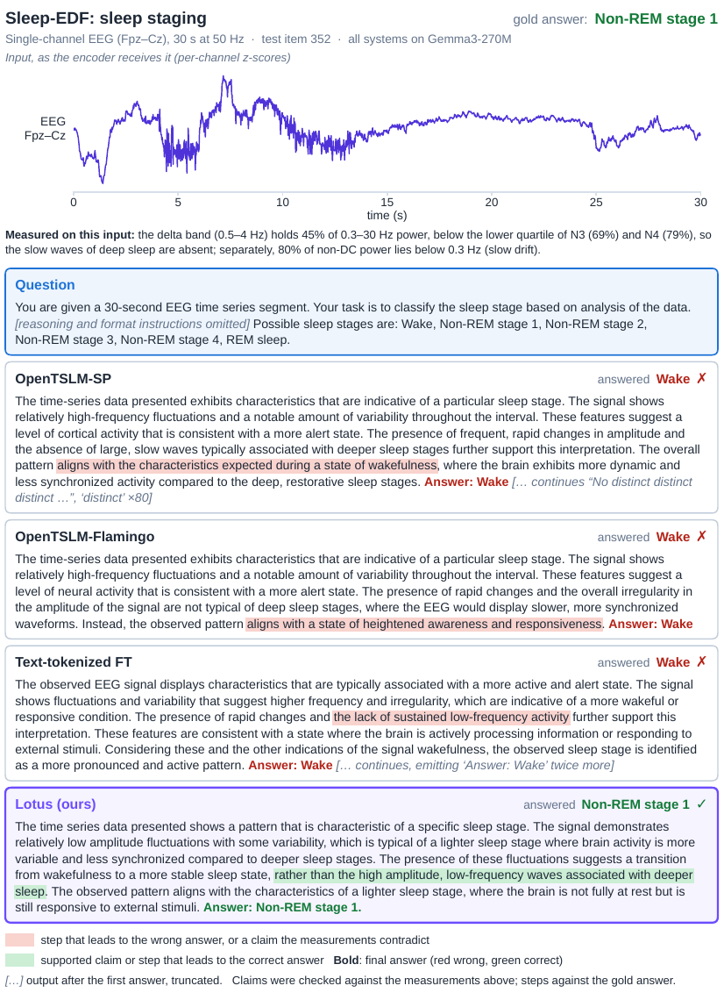
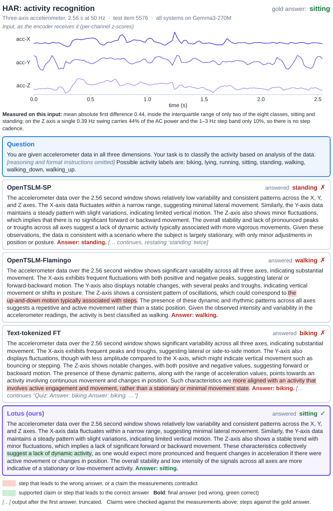
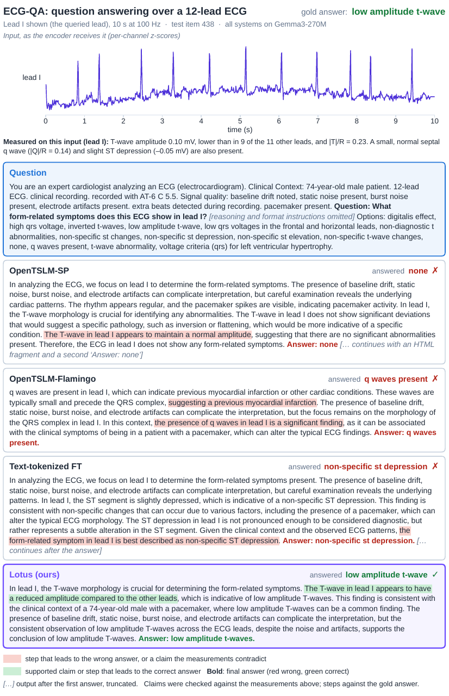
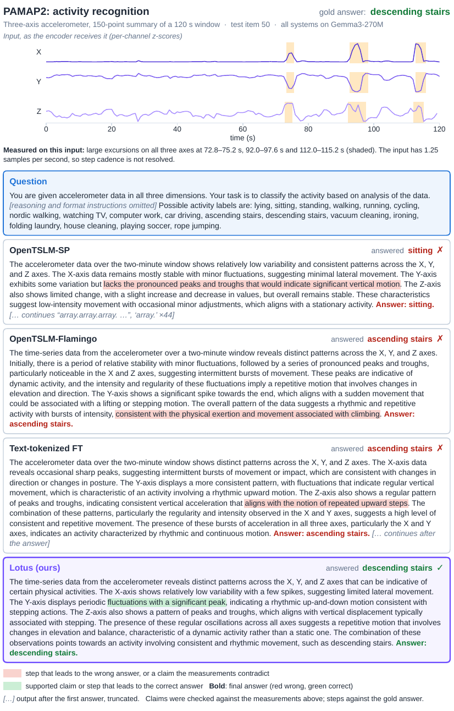

<!--
SPDX-FileCopyrightText: 2026 Deakin University and the LOTUS authors

SPDX-License-Identifier: MIT
-->

# Qualitative comparisons

One test item per downstream corpus, with every system built on Gemma3-270M (paper
Appendix "Qualitative Comparisons"). Each figure shows the input series as the encoder
receives it (per-channel z-scores), the question with the reasoning and format
instructions omitted (the full templates are in [`prompts.md`](prompts.md)), and each
model's rationale up to its first answer; any text generated after that answer is
truncated.

Highlights were checked against measurements on the input, reported under each series.
**Red** marks a wrong answer or a claim the measurements contradict; **green** marks the
correct answer and the claim it rests on. Claims the measurements support are left
unmarked, including in wrong answers.

Two failure modes recur. Some baselines describe the signal correctly but answer a
different question, as on ECG-QA, where two baselines report a q wave or ST depression that
is present in the recording instead of the queried T-wave finding. Others misread the
signal itself, as when OpenTSLM-SP describes the PAMAP2 window as stationary despite three
large excursions. In all four examples OpenTSLM-SP and the text-tokenised baseline also
keep generating after their first answer, repeating tokens or restating the answer.

The prediction files written by `evaluation/cot/eval_cot_phase2.py`
(`<task>_test_predictions.jsonl`) carry every field needed to reproduce these panels:
the prompt, the gold answer, and the full generated text.

## Sleep-EDF

All three baselines read the epoch as wakefulness; LOTUS places it in a lighter sleep
stage, consistent with its spectral centroid.

## HAR

LOTUS and OpenTSLM-SP share their first 360 characters verbatim and differ only in the
final label; OpenTSLM-Flamingo describes a stepping motion that the Z-axis spectrum does
not show.

## ECG-QA

The q wave and ST depression cited by two baselines are present in the recording but are
not the queried finding; LOTUS identifies the reduced T-wave amplitude in lead I.

## PAMAP2

OpenTSLM-SP misses the three shaded excursions and answers sitting. Per-channel
normalisation removes the gravity reference, so ascent and descent cannot be distinguished
from the input; the example illustrates the missed motion rather than the direction.

